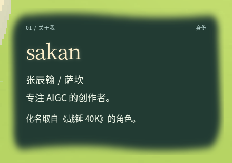

# 第一步实际基线与验收

本轮仅实施基线与设计合同。介绍背景、水球新流纹、自动导览、云影和飞鸟均尚未修改或实现；本页的“通过”指第一步规范及基线交付，不是五项新功能验收。最终机器核对见[summary.json](../evidence/garden-enhancement-step-1/summary.json)和[原文件保护](../evidence/garden-enhancement-step-1/scope-guard.json)。

## 版本与独立恢复

执行前工作区干净，HEAD、origin/main与本次只读查询的GitHub main均为`4d564f3a79e1e4cc84f9d08b043f9ac5b83c69e3`，没有发现用户后加的未保存修改。

- 4,937个原有Git文件和18个dist文件保存逐项SHA-256；10份现有release文件保存字节数与摘要。
- 当前80份实际构建输入和18份产物匹配第十二步核验过的应用`step12-95740fb789b56da7`，未重复安装/构建并冒称新构建结果。
- GitHub交接README和忽略规则晚于第十二步封包，基线按实际Git提交保存；旧ZIP保留原字节及当时状态，不把文档快照身份混淆。
- [baseline-source-site.tar.gz](../evidence/garden-enhancement-step-1/baseline-source-site.tar.gz)约2.97MB，含101份源码/公共文件/配置/成品/本机静态服务脚本，实际解压后全部SHA匹配。
- 所有浏览器采样访问**该独立解压目录**的dist（本机4176），18份实际HTTP生产文件逐项匹配摘要。采样结束关闭本步服务，用户5173/4173预览保持。

完整源码/历史资料仍在Git提交中；本tar是可运行、可重建的应用基线，不重复装入全部历史文档大图。恢复时先解压到新目录，不覆盖当前工作区。在该目录运行`node scripts/serve-dist.mjs dist 4176`即可通过HTTP查看；源码重建用`npm ci`、`npm run build`。成品运行无需复用当前工作区node_modules；浏览器模块不通过file://双击检查。

对应记录：[版本](../evidence/garden-enhancement-step-1/baseline-version.json)、[构建封印](../evidence/garden-enhancement-step-1/runtime-build-seal.json)、[压缩包内容摘要](../evidence/garden-enhancement-step-1/baseline-archive-manifest.json)、[实际解压](../evidence/garden-enhancement-step-1/baseline-extraction.json)、[原有release摘要](../evidence/garden-enhancement-step-1/existing-release-sha256.json)。

## 本次真实画面和问题

Chromium **155.0.8059.79**，Linux、ANGLE/Vulkan SwiftShader软件图形。桌面1440×900/DPR1；手机390×844/DPR2、touch/mobile浏览器模拟。正常和像素两种画面，固定环境时间2。大字样本是root rem 200%模拟，不是OS文字或本次原生浏览器缩放。

本次51张实际截图：32张八姿态×两画幅×两模式；12张完整图片/现场体验/项目档案；2张A1进入与离开；4张桌面/手机稳定阅读及200%文字；另1张介绍边缘近看。8次查看器关闭的原生位置返回保持在1CSS px内；未处理脚本异常0。数据与路径见[visual-baseline.json](../evidence/garden-enhancement-step-1/visual-baseline.json)。

介绍边缘现状：



四组画幅/模式下，当前SVG遮罩以420×240固有坐标在浏览器实际栅格化后，最外缘alpha最大值为：左25、右43、上23、下28（满值255）。右边残留约16.86%，支持“羽化边界没有完整收至透明”的诊断。当前伪元素的box-shadow和filter均为none；模糊在SVG遮罩内部。该读数是遮罩残余值，不冒充所有场景下最终合成像素的不透明度，也不能仅凭此一个值替代后续完整边缘视觉评审。

来源：[边缘测量](../evidence/garden-enhancement-step-1/about-edge-measurement.json)。第二步据此修复，当前缺陷有意保留在基线。

水球现状：已有轻悬浮、形变、水滴与较弱明暗变化，尚无本轮要求的明显连续球面流纹。[8.84秒原速录像](../evidence/garden-enhancement-step-1/water-orb-baseline.mp4)包含实际正常/像素切换及播放/暂停；转码前后时长一致，无加速。暂停后的环境时间保持不变，录像不作为性能证明。来源：[录像动作与元数据](../evidence/garden-enhancement-step-1/water-orb-recording.json)。

当前五项现状、来源与后续步骤见[issue-register.json](../evidence/garden-enhancement-step-1/issue-register.json)。现有树影仅轻微摇动，尚无掠过庭院的云影；应用源码尚无鸟群模块，界面尚无自动导览控制。

## 正文与导览设计结果

十站正文从实际基线DOM取得，顺序A1/A2/A3/B1/B2/B3/B4/C1/C2/C3保持；标题、正文、非空白Unicode码点和按钮文字见[content-inventory.json](../evidence/garden-enhancement-step-1/content-inventory.json)。码点不是阅读速度，停留同时考虑观察画面与实际读序。

[交互合同](step-1-interaction.md)确定独立导览与环境按钮、五类状态、手动接管、查看器/隐藏/图形恢复、稳定阅读和减少动态规则。十站完整停留合计90秒；加开场/水潭共106秒，配合既有转场，初值总长约131.5～148.5秒。此为已定稿的试作节奏，页面尚未安装计时器或导览功能。

[设计规范](step-1-design.md)确定深绿雾幕、水球三层流水感、世界坐标云影、三只鸟的试作范围、正交投影约束、统一时间/绘制、保护项、资源目标和后续验收。各项参数明确标为设计初值，不当作已实测的新效果。

## 本次运行基准

在独立基线上先单独完成性能采样，随后才截图和录屏，没有另一浏览器/录屏/截图与有效样本采集并行。当前正式首页使用适配后的host发现探针；读数仍为原生wheel后至真实相机settled信号的时间，未改应用。

| 指标 | 本次实测 |
| --- | --- |
| 浏览器/画幅/DPR | Chromium155，1440×900，DPR1 |
| 模式/环境时间 | pixel384，环境固定2；先pixel→native→pixel完整路线预热 |
| 输入 | T01/.9、T12/4.05、T23/8.35、T3W/11.26、WIDE/11.66；每处+15px×3、−15px×3 |
| 有效样本 | 30次；完整值和分组保留 |
| p95 | 约190.6ms；沿用排序后floor((n−1)×.95)索引口径 |
| 最大值 | 约206.1ms |
| 预热几何/纹理 | 58 / 6 |
| 程序 | 单pixel预热12；双模式预热后合计22 |
| 结尾全景绘制调用 | pixel68 / native67，包含各模式自身绘制路径 |
| 像素采样/实际输出 | 384×211 / 1440×793；整窗口1440×900，底栏另占高度 |

来源：[latency-baseline.json](../evidence/garden-enhancement-step-1/latency-baseline.json)。五个位置各六个样本不当作各位置独立p95。上述是本轮新基准，不沿用旧182.8ms作本次值，也不比较不同采样条件来宣称性能提高/下降。后续同条件比较，软件数据不代表实际GPU/手机FPS。

## E01～E10签收

| 条件 | 结果与证据 |
| --- | --- |
| E01 | 通过：执行前工作区干净，GitHub main与HEAD一致，版本记录持久保存 |
| E02 | 通过：构建输入/18份产物精确对应，10份原有release摘要保存，101文件基线实际解压 |
| E03 | 通过：51张真实截图、四组遮罩读数和8.84秒原速水球录像，现状与目标分列 |
| E04 | 通过：四项视觉设计都有初值、保护项、实施位置及可观察验收方法 |
| E05 | 通过：开始/停止/继续/不可用/结束及中文按钮含义明确，默认手动 |
| E06 | 通过：原生输入、选字、查看器、隐藏/异常恢复的控制权与续播规则明确 |
| E07 | 通过：环境时间与导览状态分离，唯一绘制系统和停留调度原则明确 |
| E08 | 通过：十站实际内容与H对应，完整显现后计时、逐站停留及恢复/转场定义完整 |
| E09 | 通过：保护范围、51图/录像、30次输入基准、资源目标及后续平台验收齐全 |
| E10 | 通过：scope-guard确认4,937个原Git文件、18份dist与10份release逐项未变，仅新增本步文档、证据及采样工具 |

## 复用采样和当前存放

在新的空目录解压基线后，用其静态服务脚本在4176运行。原仓库中使用已安装的Python Playwright、Chromium与ffmpeg：

```bash
python3 tests/garden-enhancement/step1_baseline.py --phase latency
python3 tests/garden-enhancement/step1_baseline.py --phase capture
python3 tests/garden-enhancement/step1_record.py
```

三个命令按顺序运行，latency期间不并行浏览器/截图/录像。复验应使用`--out`指定新的目录，并先放入该目录所需baseline-version/runtime-build-seal证明，避免覆盖本次证据。`PLAYWRIGHT_BROWSERS_PATH`需指向安装的浏览器缓存以支持录屏；主浏览器沿用`/usr/bin/chromium`，其他机器按实际安装位置调整采样工具。完整历史依赖条件仍由原测试说明记录。

本步成果保存在工作区`docs/garden-enhancement/`、`docs/evidence/garden-enhancement-step-1/`和`tests/garden-enhancement/`。原GitHub版本保持，新增本步内容尚未提交/推送；没有部署。结束停在第一步审阅点，第二步尚未执行。真机、OS大字/安全区、实际读屏、物理触控板/APZ和硬件FPS仍待相应条件复核。
