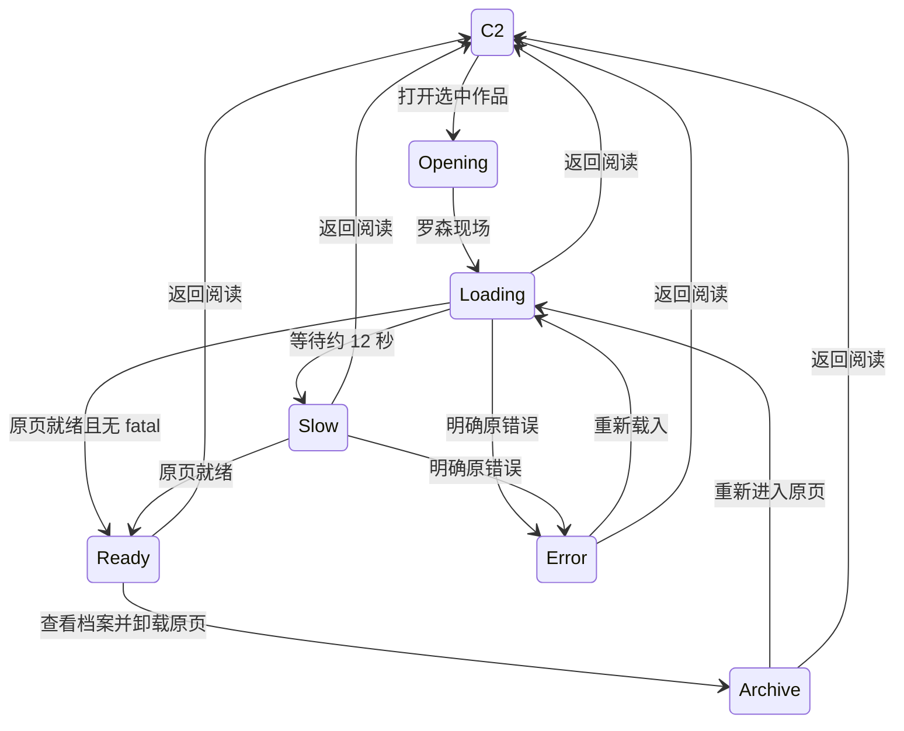

# 第二步设计定稿：Coding 展位与原网页体验层

第二步交付已完成，范围为设计、静态交互样稿及实现契约。主站正式展位、原网页复制与 iframe 接入分别属于第三至第五步。本稿以 [执行标准](step-2-standard.md) 和 [第一步验收](step-1-verification.md) 为输入。

## 可查看的样稿

- [打开静态交互样稿](../evidence/lawson-fullpage-step-2/design-preview.html)：可选择作品、打开现场布局、切档案、返回、演示加载/慢载入/错误及放大文字。
- [桌面展位](../evidence/lawson-fullpage-step-2/run-4/entry-1440x900.png)
- [桌面体验层](../evidence/lawson-fullpage-step-2/run-4/live-1440x900.png)
- [手机体验层](../evidence/lawson-fullpage-step-2/run-4/live-390x844.png)
- [档案布局](../evidence/lawson-fullpage-step-2/run-4/archive-1440x900.png)

样稿明确标注“设计样稿 / 静态参考”。现场区域是原截图；原页的按钮、车辆和漫游在本样稿中没有运行。左侧章节文字与全景背景用于提供设计上下文，正式接入时保留现有 C2 运镜及柱旁定位，不把它替换成新的平面首页。

## 1. C2 展位

沿用第三根柱子 C2，区间 9.5–10.5、停留点 10.05 不变。站点标签定为“交互作品”；C1、C3 保持原内容。

作品选择采用两个页签：LAWSON / 罗森便利店、COURTYARD / 庭院习作。首次默认罗森；选择只保留在本次页面会话，关闭作品后不丢失，刷新回到默认。一次只呈现一份详情，避免柱旁堆高。

| 内容 | 罗森 | 庭院 |
|---|---|---|
| 名称 | 罗森便利店 | 庭院习作 |
| 类型 | 交互网页场景 | 交互网页场景 |
| 摘要 | 在一家微缩便利店里，切换昼夜，观察店员与车辆。 | 一座可以停留、切换和探索的庭院。 |
| 主按钮 | 进入完整网页 | 现场体验 |
| 次按钮 | 项目档案 | 项目档案 |
| 运行类型 | 独立原网页 | 主庭院画布 |

桌面预览面板宽度不超过 500px，内边距 24px；封面常规高度 160px，320px 小屏为 140px。主按钮浅金底，次按钮深绿细框。罗森蓝仅用于当前作品指示，文字延续原浅色魔法风格。

作品切换会更新标题、封面、摘要、入口与可访问名称。页签使用方向键、Home/End 选择，只有当前项进入 Tab 顺序。切换表示访客接管，正式接入时停止自动导览；样稿仅示意这一状态。

封面仅用图片。当前罗森封面来自源仓库已有 `cherry_final_hero.png`，庭院来自现有 `courtyard-orb-cover.webp`；均逐字节复制，不编辑原图。罗森封面是源存档参考，不能代替第一步当前运行截图的验收证据。

## 2. 完整原网页的外层

沿用一个作品 dialog。罗森模式采用紧凑工具栏 + 剩余页面区域，外层没有额外侧栏、底部操作栏或卡片式最大宽度。

工具栏排列为：作品名称、现场体验/项目档案、独立打开、返回阅读。移动端缩为“罗森 / 体验 / 档案 / ↗ / 返回”，为图标及简称保留完整可访问名称。

| 模式 | 条件 | 正常字号工具栏 |
|---|---|---:|
| 常规 | 宽 > 767px 且高 > 480px | 56px |
| 紧凑 | 宽 ≤ 767px 或高 ≤ 480px | 48px |

已测量的外层可用区域：

| 视口 | 工具栏高度 | 页面区域 |
|---|---:|---:|
| 1920×1080 | 56 | 1920×1024 |
| 1440×900 | 56 | 1440×844 |
| 1366×768 | 56 | 1366×712 |
| 768×1024 | 56 | 768×968 |
| 390×844 | 48 | 390×796 |
| 320×568 | 48 | 320×520 |
| 844×390 | 48 | 844×342 |

实际采用可视视口高度和工具栏自然高度。200% 文字可换行，安全区按设备值扣除，返回及主要操作不裁切。

本样稿的截图使用 contain 以完整显示图片；该规则仅属于图片参考。正式 iframe 的宽高为页面区域的 100%，不继承 object-fit、固定比例、缩放、裁切或滤镜。移动端会由原网页自己按 iframe 视口重新排版，不能从本样稿推断最终原页构图。

“设计样稿”浮动菜单用于演示状态和文字尺寸，属于审阅工具，正式作品层不保留。

## 3. 档案布局

档案与现场共用同一个作品身份。桌面采用标题/介绍双栏、整幅场景图、三项功能概览；手机改为单列，长内容在档案区域内滚动，顶部返回持续可用。

罗森标题为“一间店，几个日夜。”，功能概览按昼夜灯光、店员车辆、镜头场景组织。文案不承诺已知受限的漫游移动或物件车体点击均正常。庭院保留原介绍，标题采用“停一会儿，看风经过。”。

样稿只完成档案的信息层级与版式，现有庭院视频、早期帧图及完整档案内容在第四步保留接回，不以样稿中的三项概览替换。罗森档案也不得虚构制作履历、商业合作或未提供的过程资料。

## 4. 操作与生命周期

- 打开时使用现有 capture/restore 记录阅读模式、C2 锚点、段内位置与运镜进度。停止导览，罗森现场打开时庭院停止绘制。
- 返回恢复本次作品选择与原阅读位置，恢复打开前的环境播放设置，导览等待手动继续。
- 罗森切档案或关闭时卸载；重新进入从原页默认状态开始。只保存主站阅读状态，不承诺保存已卸载的现场。
- “独立打开”最终与 iframe 共享同一入口。样稿中它打开 `?standalone=lawson` 静态参考页，绝不冒充已接入原网页。
- 背景锁滚动，原页内部输入和滚动按原逻辑处理。禁止全局拦截所有 wheel/touch。
- 焦点在原页内时，Esc 交给原页处理，宿主 dialog 不因此关闭；焦点在宿主外层时可用 Esc 返回。原生全屏退出后再使用宿主返回。
- 样稿的 Esc 检查使用可聚焦静态参考区，没有真实 iframe、鼠标锁定或原生全屏；这些在第五/第六步验证。

## 5. 状态呈现

正常状态只显示紧凑工具栏和原网页。loading 保留原加载页，slow 通过简洁状态与重试入口提示，error 保留原错误/重试，不用宿主遮罩覆盖它。约 12 秒的 slow 仅是宿主等待提示；原页约 30 秒启动守卫保持原样。

原页未明确报错时不伪装确定失败。判定顺序、旧实例回调和原页重试后的文档重建规则见 [接口契约](step-2-interface.md)。

减少动态设置下取消打开动画；正常打开采用 160ms 淡入，作品预览切换采用 120ms 淡入。动画只作用于宿主，不对正式原页做缩放或变形。

## 6. 正式接入的边界

主庭院故障与罗森原页可用性分别处理，不能因为庭院失败就禁用罗森尝试入口。两者档案和返回始终保留。

罗森源码与依赖仍按第一步 46 文件原样迁移。原版手机界面、碰撞、复位、快捷键等已知问题继续列在 [原页问题](original-issues.md)，本设计不把它们写成已解决。真实后台隐藏、实际手机及浏览器权限仍待后续验证。

完整执行记录见 [第二步验收](step-2-verification.md)，直接承接第三步见 [交接清单](step-2-handoff.md)。
