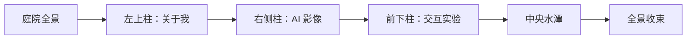
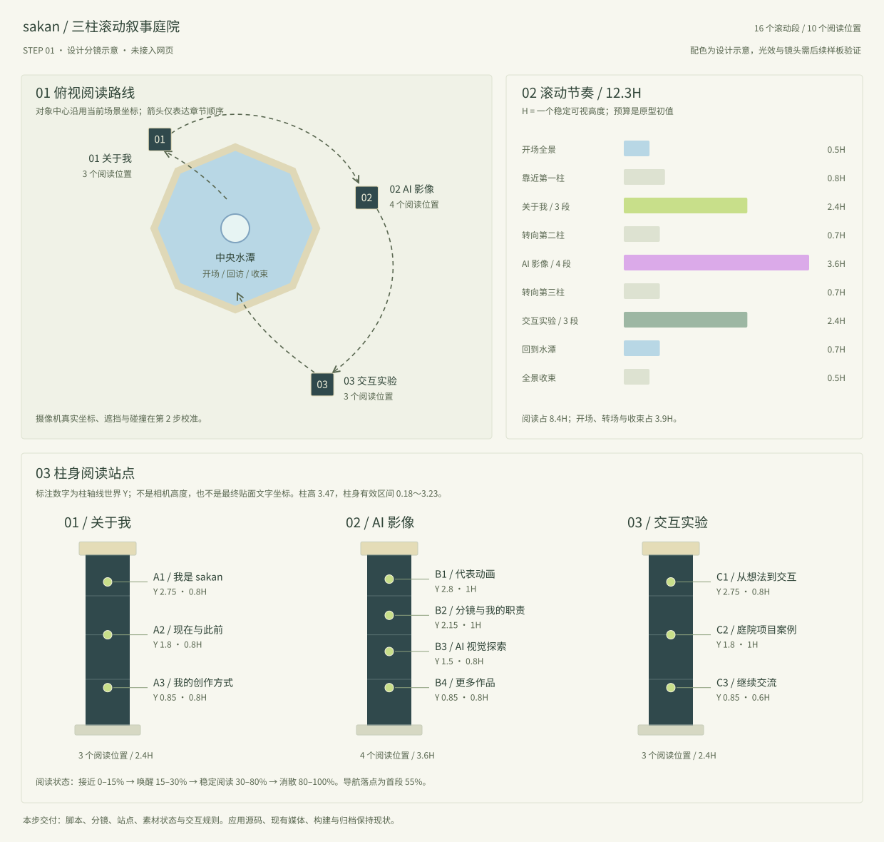

# 第 1 步：三柱叙事脚本与滚动运镜分镜

状态：本步设计交付。用户已明确授权执行第一步；后续步骤尚未执行。当前应用仍为此前的固定视角作品集参考稿。本文件定义未来滚动庭院的内容和行为，不表示这些镜头、文字或水球已经出现在网页中。

## 1. 设计目标与本步范围

访客用滚动进度进入同一座庭院：先看全景，再依次靠近三根石柱。柱面唤醒浅色魔法文字，镜头沿柱身下降，旧内容退出、新内容进入。中央水潭连接开场、跨章的空间关系和最后收束。

本步完成浏览路线、十个阅读位置、十六个滚动段、内容草案、显隐规则、导航目标和素材清单。摄像机最终位置、遮挡、碰撞、真实阅读清晰度和水球视觉效果，需要后续原型验证；本步不修改它们。

配套文件：[结构化设计数据](step-1-plan.json)、[站点表](step-1-stations.csv)、[路线设计图](step-1-route.svg)、[审查记录](step-1-review.md)。

## 2. 当前场景约束

已核对 [layout.ts](../../src/config/layout.ts) 与 [scene.ts](../../src/config/scene.ts)。场景使用 Y 轴向上、原点位于各柱地面的坐标。

| 对象 | 当前位置 `[x,y,z]` | 未来用途 |
| --- | --- | --- |
| 左上柱 `columnUpperLeft` | `[-2.34,0,-2.9]` | 01／关于我 |
| 右侧柱 `columnRight` | `[4.41,0,-1]` | 02／AI 影像 |
| 前下柱 `columnLower` | `[2.96,0,5.09]` | 03／交互实验 |
| 水潭 `fountain` | `[0.12,0,0]` | 开场、空间联系与收束 |

三柱总高 **3.47**；柱身宽 **0.72**、深 **0.78**，有效柱身高度范围为 **Y=0.18～3.23**。阅读锚点位于柱轴线，表示叙事关注的高度，不等于摄像机高度，也不是最终文字贴面坐标。贴面偏移、正文展开和遮挡处理留到第 3、4 步校准。

全景沿用当前正交相机：位置 `[4.5,23,16]`、注视点 `[0,0.45,0]`、取景高度 `11.3`。新镜头继续保持近似等距观感，以平移、缩小取景范围和降低俯角推进；阅读时聚焦局部柱身，文字有独立的清晰阅读区域。

## 3. 路线与镜头语言

每根柱子都遵循「建立方位 → 靠近上部 → 沿柱下降 → 离开」的节奏。

| 镜头类别 | 画面目标 | 衔接约束 |
| --- | --- | --- |
| 全景 | 识别水潭、三柱、草花和个人身份 | 保留原有场景关系，开场与最终全景使用相同基础姿态 |
| 靠近 | 先认出整根柱，再进入上部阅读位置 | 目标柱逐渐进入主要构图区；取景与角度连续变化 |
| 阅读 | 柱子偏左，正文在柱前和邻近区域展开 | 正文朝向阅读视线，背景有柔和深色雾影承托；影像获得充分宽度 |
| 沿柱下降 | 摄像机与注视点一起降低，进入更低的锚点 | 上段向上退出，下段进入；路径连续跨越段落交界 |
| 跨柱 | 略拉开、抬起，沿水潭外围转移，再靠近下一柱上部 | 保持稳定上下方向，明确下一章的方位；正文在途中隐藏 |
| 水潭收束 | 水球重新成为中心，再恢复全景 | 只定义叙事角色；水潭与水球美术升级分别在第 8、9 步 |

镜头最终坐标和具体曲线不是本步已验证参数。第二步需要验证实际路径是否穿模、被其他物体遮挡、越过地面或在交界跳变。

## 4. 完整滚动分镜表

**H = 一个稳定可视高度。** 12.3H 表示叙事可滚动距离；实际文档还需要一屏容器布局空间。每次调整窗口，应保留「当前段 ID + 段内进度」，再计算新距离。以下是桌面原型预算，后续根据原型评审调整。

| 段 ID | 区间 H | 距离 H | 焦点／内容 | 镜头动作与交接 |
| --- | --- | --- | --- | --- |
| S00 | 0～0.5 | 0.5 | 庭院与 sakan 身份 | 保持全景，显示身份和向下浏览提示 |
| T01 | 0.5～1.3 | 0.8 | 前往左上柱 | 平移、靠近、降低俯角，进入 A1 上部阅读区 |
| A1 | 1.3～2.1 | 0.8 | 我是 sakan | 关注 Y=2.75，阅读后开始向下离开 |
| A2 | 2.1～2.9 | 0.8 | 现在与此前 | 关注 Y=1.80，展示两条真实经历 |
| A3 | 2.9～3.7 | 0.8 | 我的创作方式 | 关注 Y=0.85，收束第一章 |
| T12 | 3.7～4.4 | 0.7 | 前往右侧柱 | 正文隐藏，镜头拉开抬起，沿水潭外围转移 |
| B1 | 4.4～5.4 | 1.0 | 代表动画 | 关注 Y=2.80，主海报从柱旁展开 |
| B2 | 5.4～6.4 | 1.0 | 分镜与我的职责 | 关注 Y=2.15，展示对应作品的过程与贡献 |
| B3 | 6.4～7.2 | 0.8 | AI 视觉探索 | 关注 Y=1.50，根据素材画幅组织画面组 |
| B4 | 7.2～8.0 | 0.8 | 更多作品 | 关注 Y=0.85，提供少量真实项目入口 |
| T23 | 8.0～8.7 | 0.7 | 前往前下柱 | 镜头拉开抬起，建立前景柱与水潭关系后再次靠近 |
| C1 | 8.7～9.5 | 0.8 | 从想法到交互 | 关注 Y=2.75，引入 Vibe Coding |
| C2 | 9.5～10.5 | 1.0 | 庭院项目案例 | 关注 Y=1.80，展示已有真实场景成果 |
| C3 | 10.5～11.1 | 0.6 | 继续交流 | 关注 Y=0.85，简短收束并预留真实联系入口 |
| T3W | 11.1～11.8 | 0.7 | 回到中央水潭 | 离开柱子，水球进入中心，逐渐扩大取景 |
| S99 | 11.8～12.3 | 0.5 | 庭院全景与结语 | 恢复基础全景，显示回到开场入口；停在结尾直到再次操作 |

预算分组：开场 0.5 + 靠近 0.8 + 关于我 2.4 + 转场 0.7 + 影像 3.6 + 转场 0.7 + 交互 2.4 + 回水潭 0.7 + 收束 0.5 = **12.3H**。这是滚动距离，不能换算成强制播放秒数或固定滚轮格数。

## 5. 十个阅读位置的文案与媒体

### A1／我是 sakan

- 章节：01／关于我；左上柱上部，Y=2.75。
- 正文草案：**我是张辰翰，也叫 sakan（萨坎），一名专注 AIGC 的创作者。**
- 注脚：sakan（萨坎）这个化名，取自《战锤 40K》的角色。
- 展示：柱面编号、小符印、姓名与短介绍。无需编造头像或职业头衔。

### A2／现在与此前

- 位置：左上柱中部，Y=1.80。
- 正文草案：**目前在枫叶互动制作 AI 动画，此前曾在游族网络工作。**
- 两条记录：NOW／枫叶互动 · AI 动画；BEFORE／游族网络。
- 内容边界：没有提供年限、职级、具体项目或业绩，页面不增加这些信息。

### A3／我的创作方式

- 位置：左上柱下部，Y=0.85。
- 正文草案：**熟悉主流 AI 图像与视频工具，也使用 Vibe Coding，把想法变成可以交互的体验。**
- 三个短语：图像构建／影像制作／交互表达。
- 展示：文字与少量几何符印；引向下一章的影像内容。

### B1／代表动画

- 章节：02／AI 影像；右侧柱上部，Y=2.80。
- 内容：真实项目名称、一句介绍、一张海报和明确播放入口。
- 当前状态：**待提供真实个人动画及海报**，设计稿使用明确占位。
- 画面：保持来源比例的宽幅或竖幅画框，从柱身旁展开；不能把庭院录屏当作 AI 动画正片。

### B2／分镜与我的职责

- 位置：右侧柱中上部，Y=2.15。
- 内容：与 B1 对应的两到三张关键画面、过程说明和本人负责内容。
- 当前状态：**待提供同一项目的真实素材与职责**。
- 展示：画面优先，说明简短；不预填未经提供的制作流程、工具组合或商业成绩。

### B3／AI 视觉探索

- 位置：右侧柱中下部，Y=1.50。
- 内容：个人视觉作品及简短说明。
- 当前状态：真实作品待补。现有「异星来信」「流动标本」可作为**明确标注的概念样片**说明版式。
- 展示：根据横幅、竖幅组织主画面和局部，保持与当前柱子的视觉联系。

### B4／更多作品

- 位置：右侧柱下部，Y=0.85。
- 内容：少量其他真实项目入口。
- 当前状态：项目目录待补；当前只保留设计站位。
- 后续规则：没有真实条目时，可在内容评审时调整本站位；不生成失效按钮或虚构项目。调整需要同步滚动预算。

### C1／从想法到交互

- 章节：03／交互实验；前下柱上部，Y=2.75。
- 正文草案：**我也使用 Vibe Coding，把视觉构想进一步做成网页与交互体验。**
- 展示：短句与一个几何符印，建立这一章的创作方向。

### C2／庭院项目案例

- 位置：前下柱中部，Y=1.80。
- 正文草案：**以这座庭院作为交互案例，展示场景、画面与页面体验之间的关系。**
- 已有素材：固定视角庭院截图、12 秒无声演示和采样画面。
- 状态边界：现有庭院是真实成果；新运镜和魔法文字目前仍是计划，完成对应阶段后再作为已实现能力展示。
- 展示：项目档案／说明入口；退出档案返回本站位。

### C3／继续交流

- 位置：前下柱下部，Y=0.85。
- 结语草案：**让想象，动起来。**
- 联系入口：待提供允许公开的真实邮箱或社交账号。
- 未提供时只保留结语，设计中预留位置，不虚构联系方式。

## 6. 深柱浅字与魔法显隐

文字分为柱面识别层和阅读层。编号、短标题与符印依附石面；正文从柱面附近展开，朝向阅读视线，保持屏幕阅读字号。展开区域背后用边缘渐隐的深色雾影承托。

| 部位 | 颜色方向 |
| --- | --- |
| 承载文字的柱面 | 深青灰、略带墨绿，保留石材细节 |
| 柱顶受光面 | 暖浅石色 |
| 章节标题 | 浅象牙白，少量淡金边光 |
| 正文 | 稳定的浅白绿 |
| 魔法细节 | 少量淡水蓝和淡紫 |

正文初拟桌面 16～18 CSS px、手机 15～16 CSS px，完整阅读状态的目标对比度至少 4.5:1。颜色与字号为后续样板的设计目标，尚未完成实际画面测量。场景保留像素质感，正文独立保持清晰。

每个阅读段使用相同的段内进度：

| 段内进度 | 行为 |
| --- | --- |
| 0～15% | 接近阅读位置，上一段正文完成退出 |
| 15～30% | 符印唤醒，标题先出现，正文随后凝聚 |
| 30～80% | 主阅读区，正文满可读亮度，镜头漂移很小 |
| 80～100% | 文字消散，细光向下引导，镜头进入下一阅读区 |

边界使用连续状态：100% 时离开正文已隐藏。相邻段之间的下降跨越「上一段离开」与「下一段接近」，不能在交界突然换坐标。同一时刻只有一个主要段落处于完整阅读状态。

显隐跟随滚动位置；向上滚动时反向恢复。停滚后主文字保持当前状态。边缘微粒可按环境节奏轻微活动，阅读正文的亮度保持稳定。具体符印绘制、粒子和字缘表现属于第 4 步。

## 7. 输入、导航和影片的行为合同

| 情况 | 约定行为 |
| --- | --- |
| 鼠标滚轮、触控板、触摸与键盘 | 控制同一条实际滚动进度，原始滚轮增量不作为独立剧情计数器 |
| 停止输入 | 镜头短暂收敛后稳定，原型目标约 0.2 秒；还未实测 |
| 快速滚动 | 直接求对应位置，不积压待播放镜头；画面与正文保持同一段状态 |
| 反向滚动 | 相同位置恢复相同叙事镜头与文字；环境水波不必倒放 |
| 窗口变化 | 保留当前段和段内比例，重新计算 H 与屏幕取景 |
| 点击章节 | 进入该章首站的完整阅读区，保留手动暂停选择与画面模式 |
| 播放正片 | 保存当前段与局部进度，放映时背景进度保留；关闭后恢复原位并停止已关闭媒体 |
| 停止滚动 | 水球、水面与草花仍按环境时间轻微运动 |
| 暂停环境动效 | 环境静止，章节滚动与导航继续可用 |
| 减少动态 | 使用稳定章节视图与直接导航，抑制连续运镜和装饰粒子；具体适配在第 11 步 |

章节入口选择首站段内 **55%**，位于 30～80% 的完整阅读区：

| 入口 | 目标段 | 叙事位置 |
| --- | --- | --- |
| 庭院／回到开场 | S00 | 0H |
| 关于我 | A1 的 55% | 1.74H |
| AI 影像 | B1 的 55% | 4.95H |
| 交互实验 | C1 的 55% | 9.14H |

这些是设计目标，不是在第一步新增的网页 URL 或导航实现。结尾保持在 S99，只有明确的“回到开场”操作才返回 S00。

## 8. 素材清单与缺口

| 编号 | 素材 | 状态与安排 |
| --- | --- | --- |
| E01 | [庭院截图](../../src/assets/courtyard.png) | 已有真实项目素材，供 C2 使用 |
| E02 | [12 秒无声庭院演示](../../src/assets/courtyard-motion.mp4)、[采样帧 1](../../src/assets/courtyard-keyframe-00.png)、[采样帧 2](../../src/assets/courtyard-keyframe-03.png) | 已有场景演示；不是个人 AI 动画项目，也不是硬件帧率证据 |
| E03 | [异星来信](../../src/assets/signal-garden.webp)、[流动标本](../../src/assets/liquid-form.webp) | 本次网页设计生成的概念样片，只能带标识作 B3 版式示意 |
| M01 | 个人代表动画、真实名称、海报与一句介绍 | 待提供，用于 B1 |
| M02 | 同一项目关键帧、过程与本人职责 | 待提供，用于 B2 |
| M03 | 个人 AI 视觉作品及说明 | 待提供，用于 B3 |
| M04 | 其他真实项目目录与可用入口 | 待提供，用于 B4 |
| M05 | 允许公开的真实联系方式 | 待提供，用于 C3 |

缺口不会阻止第二步无内容运镜原型。第六步接入真实影像前，需要按素材状态评审，不把概念示意改标成个人实际作品。

## 9. 向第二步交接

第二步需先单独提出详细执行标准，并获得用户的明确开始指示。原型先验证全景、三柱首站之间的路线、返回水潭和完整反向路径。章节阅读区可暂时停在各柱首站，仅显示简单位置编号。

沿第一根柱子的逐段下降阅读属于第 3 步；深色柱面和魔法文字属于第 4 步；完整正文、其他两柱、水潭和水球分别按后续阶段实施。本步交付不自动授权这些工作。

验收记录见 [第一步审查](step-1-review.md)，本次运行的一致性和文件保护记录见 [核对结果](../evidence/scroll-garden-step-1/verification.json)。
