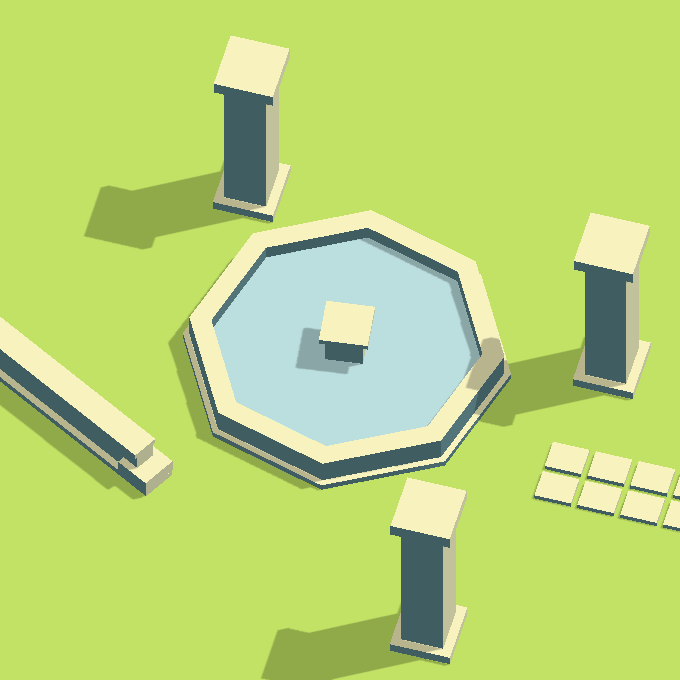
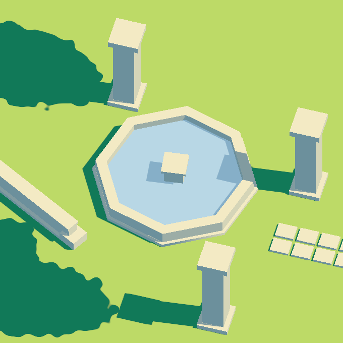

# 第三步：光影与配色

> 本文记录第三步的光影验收。第四步沿用这些参数并细化石头几何体，当前造型见 [第四步记录](step-4-stone.md)。

## 执行范围

保留第二步相机、模型布局、几何结构和像素比例，建立暖亮部、蓝青暗面、黄绿地面与深青绿阴影的关系。调整主光方向、补光强度和投影精度，并加入两组只作用于地面的初步树影。模型破损、草地细节、花草、水面动画与最终像素色阶仍留在后续步骤。

## 同构图对照

两张场景截图都是 680 × 680，不包含网页边距。相机、模型位置与尺寸一致，变化来自材质和光照。

| 第二步基础光照 | 第三步光影配色 |
| --- | --- |
|  |  |

[第二步原图](evidence/step-2/composition-native.png) · [第三步原图](evidence/step-3/composition-native.png) · [第三步像素画面](evidence/step-3/composition-pixel.png)

## 固定内容

- 相机：正交，position `[4.5,23,16]`，target `[0,0.45,0]`，viewHeight `11.3`。
- `layout.ts` 内容摘要与第二步一致。
- 六个具名模型组的逐顶点投影边界、地面锚点与第二步一致。
- 仍为 28 个网格、5 个复用几何体，材质统一为草地、石头、水面 3 个。
- 正常模式 DPR 上限为 2；像素模式内部比例 0.5、DPR 为 1。
- 依赖、锁文件、页面样式和界面控件代码保持不变。

## 主光、补光与阴影

参数集中在 `src/config/lighting.ts`：

| 参数 | 当前值 | 用途 |
| --- | --- | --- |
| sun.position | `[8.5,11,-1]` | 投影向画面左侧略向上，避免下方柱影被底边切断 |
| sun.intensity | `1.0` | 方向光强度及风格化受光响应 |
| fill.intensity | `0.75` | 补光及蓝青暗面的亮度控制 |
| shadows.mapSize | `2048` | 提高固定视角下的投影精度 |
| shadows.extent | `8` | 阴影相机左右、上下均为 ±8 |
| shadows.near / far | `0.5 / 32` | 覆盖场景中的投影物体 |
| shadows.bias | `-0.0001` | 深度比较偏移 |
| shadows.normalBias | `0.012` | 表面法线偏移 |
| shadows.radius | `1` | 与现有 PCF 阴影过滤配合 |

以真实柱体顶点按方向光投向地面计算：下方柱影的最大画面纵坐标从第二步的 **1.0174** 降到 **0.9768**，完整回到画面内。柱体、相机与布局没有移动。

## 色板与材质响应

保留原有主要色值，增加石头侧面和水面暗部两个语义颜色：

| 参数 | 输入色值 | 用途 |
| --- | --- | --- |
| grassBase | `#BEDB68` | 受光草地 |
| grassDark | `#9EBF56` | 低照明时的草地颜色 |
| stoneLight | `#F3EAC4` | 暖色顶面 |
| stoneSide | `#D5D5B8` | 受光侧面 |
| stoneShade | `#7095A1` | 蓝青暗面 |
| treeShadow | `#117958` | 建筑投影和地面树影共同使用的目标色 |
| waterBase | `#B8D7E5` | 静态水面 |
| waterShade | `#86AFC8` | 水面上的建筑投影 |

使用 `MeshLambertMaterial.onBeforeCompile` 扩展当前锁定的 Three.js 0.187.0：保留模型变换、法线、深度、真实阴影贴图和 sRGB 输出，只替换最终颜色响应，不修改依赖库文件。

- 草地：从亮色与暗色计算日照底色，建筑遮挡读取 Three.js 的 `getShadowMask()`。
- 树影：按世界 X/Z 坐标计算遮罩，仅用于草地材质。
- 阴影重叠：取建筑遮挡与树影遮罩的最大值，再向同一青绿色混合，避免重复乘暗。
- 石头：按世界法线区分顶面，根据法线朝向主光的程度混合暖侧面与蓝青暗面，再应用真实遮挡；补光控制暗面亮度。
- 水面：静态浅蓝与蓝色暗部，根据实际投影混合。没有波纹、流动、反射动画。
- 所有色板输入先转换为线性颜色计算，再使用已有的 sRGB 输出，避免重复转换。

这套响应以画面控制为目标，不是物理 PBR 光照。补光在风格化材质中表现为明确的颜色亮度参数，同时同步到场景半球光。太阳方位直接决定实际投影和侧面的受光程度。

## 初步树影

两组大轮廓由三个世界坐标椭圆区域组成：

| 区域 | X/Z 中心 | 半径 | 旋转 |
| --- | --- | --- | --- |
| 左上组 | `[-6.1,-3.2]` | `[2.8,1.55]` | `0.08` |
| 左下组主轮廓 | `[-3.4,6.0]` | `[3.1,1.5]` | `-0.15` |
| 左下组连接轮廓 | `[-4.6,4.4]` | `[1.2,1.4]` | `0.2` |

轮廓使用确定性的低频噪声扰动，noiseScale `3.2`、noiseAmount `0.22`、edgeSoftness `0.008`。保持静止，只有基本的有机起伏。它们是地面颜色遮罩，不是树冠模型的真实投影，因此不会染色石头和水面；建筑投影仍由真实几何和方向光生成。

此阶段确定大面积明暗分布，保留喷泉上方、主体周围和右侧的明亮地面。第五步再完善碎叶边缘、疏密与植物细节。

## 实际画面颜色

同构图关键区域 3 × 3 像素中值采样，RGB 为 sRGB 输出：

| 区域 | 第三步实测 RGB |
| --- | --- |
| 受光草地 | `(189,218,103)` |
| 建筑投影 | `(17,121,88)` |
| 左上与左下树影 | `(17,121,88)` |
| 建筑与树影重叠区 | `(17,121,88)` |
| 石头顶面 | `(243,234,196)` |
| 石头蓝青暗面 | `(108,144,156)` |
| 石头受光侧面 | `(213,213,184)` |
| 受光水面 | `(184,215,229)` |

通过实际切换树影、建筑阴影、主光方向和补光强度，并还原画面，确认这些颜色来自正常工作的材质与投影机制。完整结果见 [验收报告](step-3-verification.md)。

## 后续边界

当前石柱仍规整，树影仍是大轮廓，水面静止。未加入石头破损、花草、草地细碎纹理、碎叶树影、Bloom 或像素抖动。后续美术可以沿用本步的色彩关系，同时按各阶段完善形状和细节。

用户确认第三步后，再进入第四步石头造型与破损细节。
