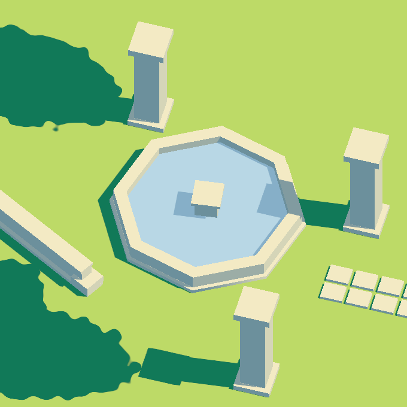
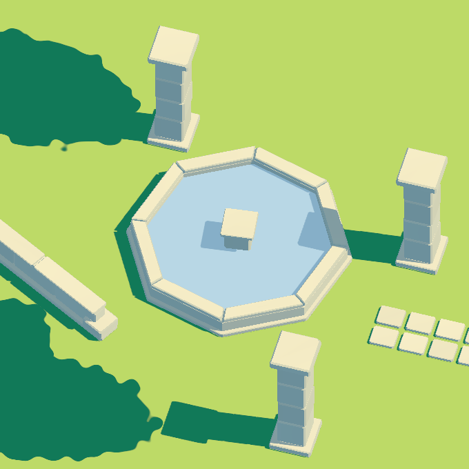

# 第四步：石头建筑造型与破损细节

> 本文保留第四步建筑验收。第五步沿用这些建筑，新增环境植物和树影细节，见 [第五步记录](step-5-environment.md)。

## 范围与构图保留

本阶段完善喷泉、三根柱子、左墙与八块石板。相机、模型组锚点与朝向、布局尺寸、第三步灯光和色板均保留。通过几何切角、分层接缝、少量缺角与轻微色差建立石头结构。

同构图对照均为 680 × 680 场景画布：

| 第三步 | 第四步 |
| --- | --- |
|  |  |

[正常画面](evidence/step-4/composition-native.png) · [像素画面](evidence/step-4/composition-pixel.png) · [手机像素画面](evidence/step-4/mobile-pixel.png)

相机、六组模型锚点完全一致。与原占位轮廓相比，各组投影边界因切角向内收缩，最大变化约为画布的 **0.274%**，低于本步 1% 检查阈值。没有通过移动相机或建筑补偿细节。

## 几何实现

`src/geometry/createStoneBlockGeometry.ts` 提供矩形石块与凸多边形石块生成：

1. 从封闭凸棱柱开始。
2. 使用平面裁切生成上下窄倒角、竖向切角和可选的一个上部缺角。
3. 为新切面补齐封闭面。
4. 每个面使用独立平面法线，保持大面平整和低模转折。
5. 生成稳定的 `stoneTint` 标量属性，供原有石头材质作细微颜色变化。

没有新增模型包、CSG 依赖、贴图服务或外部资产。几何体在初始化或配置热更新时生成，不在逐帧循环中重建。

## 石柱

三根柱子沿用 1.04 × 0.18 × 1.08 的底座、3.05 高的柱身和 1.02 × 0.24 × 1.04 的柱头，总高保持 **3.47**。

柱身分四层，权重 `[1.07,0.96,1.03,0.94]`。扣除三条 0.038 高接缝后，四块高度约为 `[0.78538,0.70464,0.75602,0.68996]`，合计加接缝后仍为 3.05。

接缝内部放置内收连接体，正面和侧面各内收 0.045；上、下石块与连接体高度连续，避免把接缝做成悬空间隙。

| 位置 | 层变体组合 | 各层 X 偏移 | 柱头缺角平面参数 |
| --- | --- | --- | --- |
| 左上柱 | `[0,1,0,2]` | `[-0.012,0.012,-0.008,0]` | 角 2，0.12 |
| 右柱 | `[1,2,0,1]` | `[0.008,-0.01,0.01,0]` | 角 1，0.095 |
| 下柱 | `[2,0,1,0]` | `[-0.008,0.012,-0.008,0]` | 角 3，0.145 |

柱头缺角参数表示裁切平面的偏移，不是整个缺口的实测宽度。根据实际截图，在初始尺度上适当加大柱头切削量，让它在已有倒角之外仍然可见，同时保留顶面与总体尺寸。

[石柱局部截图](evidence/step-4/column-detail.png)

## 喷泉

- 底座仍为半径 2.76、高 0.12 的八边形，增加窄倒角。
- 池沿仍保持外半径 2.65、内半径 2.28、顶部高度 0.58。
- 下层池壁连续，从高度 0.12 延伸至 **0.44**，高于水面 **0.32**。
- 上层压顶为八块封闭楔形石头，高 0.14；相邻石头约留 0.032 的接缝。
- 第 1、5 段的外缘角增加缺口，其余主要保持窄切角。
- 由于下层墙体连续，上层分段与缺口不会贯穿水面高度处的池壁。
- 中央台座完善边缘与台面小切角，顶部仍为 0.96，保持中心可见。

通过从池中心、在水面高度发出 32 条水平射线检查，全部命中连续内壁。水面仍为原有静态浅蓝平面。

[喷泉局部截图](evidence/step-4/fountain-detail.png)

## 矮墙与石板

左墙保持原走向、长度和高度：

- 墙身分为三块大石头，之间有内凹连接体。
- 压顶分为两块，接缝填充体略低于压顶表面。
- 墙端块体增加一个缺角。
- 底座继续保持接地。

右侧道路保留两排共八块石板及各块中心位置。石板高度仍为 0.09，轮廓增加切角，第 1、4、6 块增加小缺口。没有旋转或重新排列石板。

[石板局部截图](evidence/step-4/paving-detail.png)

## 色差与材质

继续共享第三步的草地、石头和水面三种材质。只为石头增加低幅度色差：

- 强度 `colorVariation: 0.045`，在线性颜色中计算。
- 标量由固定种子与低频位置函数生成，刷新后保持一致。
- 控制整块色差和轻微表面变化，避免高频污点。
- 暖顶面、蓝青暗面和实际投影的计算保持原逻辑。
- 地面与水面不使用该属性。

实际采样：草地 `(189,218,103)`、建筑阴影 `(17,121,88)`、水面 `(184,215,229)` 与第三步一致；石头顶面约 `(246,237,198)`，蓝青暗面约 `(107,142,154)`，属于小幅变化。

## 配置与资源统计

`src/config/stone.ts` 集中保存倒角、切角、接缝、分层、缺口和色差参数。`createBlockout.ts` 保留原组装入口，生成细化建筑，并缓存重复石块几何体。

本轮实际统计：

| 项目 | 数量 |
| --- | --- |
| 全场景网格 | 60 |
| 其中石头网格 | 58 |
| 按所有实例累加三角形 | 4,868 |
| 独立几何体 | 44 |
| 其中封闭石头几何体 | 42 |
| 材质 | 3 |

符合网格 100 以内、三角形 15,000 以内的本步预算。检查了全部 42 个独立石头几何体：封闭边成对、法线与绕序一致、体积为正、无退化三角形。44 个几何体与 3 个材质在清理时各释放一次，重复清理不会再次触发释放。

## 阶段边界

本阶段保持克制的几何破损，未加入碎石堆、苔藓、花草、水面动画或新的像素滤镜。用户确认后进入第五步草地、小花、植被和树影细节。

完整检查见 [第四步验收报告](step-4-verification.md)。
