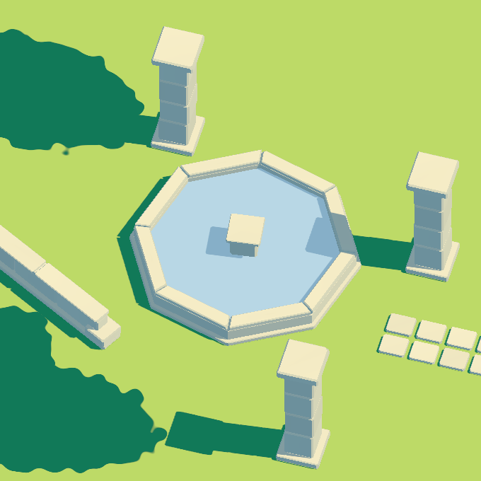
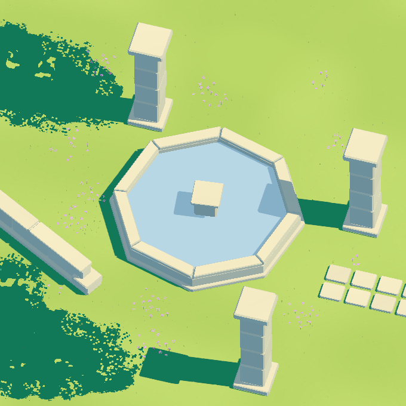

# 第五步：草地、花草与树影

> 本文保留第五步的静态环境验收。第六步沿用建筑、草花和树影，新增喷泉动效，见 [第六步记录](step-6-water.md)。

## 范围与同构图对照

保持第四步建筑的几何体、法线、色差、位置和比例，保留固定相机、主光、补光、建筑阴影与既有页面。新增静态短草、小花、草地色彩层次，以及树影碎边、透光和零散叶影。水面保持静止。

| 第四步 | 第五步 |
| --- | --- |
|  |  |

[正常画面](evidence/step-5/composition-native.png) · [像素画面](evidence/step-5/composition-pixel.png) · [手机像素画面](evidence/step-5/mobile-pixel.png)

## 分布与留白

`src/config/vegetation.ts` 使用固定种子 **52026**。植物只在初始化或配置热更新时生成，屏幕尺寸与渲染模式不参与随机数生成。

- 草簇：240 组普通短草，12 组石板缝草，共 **252 组**。
- 小花：**144 朵**，四瓣、五瓣各 72 朵，每朵另有短茎和少量叶片。
- 花簇：围绕 12 个配置区域聚集，实测各区域归属数量为 `[12,15,14,4,16,3,15,12,15,6,15,17]`。
- 留白：上方世界 X/Z 中心 `[0,-5.4]`、半径 `[1.8,1.25]` 的椭圆区域，没有花朵，仅有 2 组短草。
- 普通短草采用开阔区域与花簇附近混合分布，保留疏密。

花簇世界中心：`[-4.2,-1.2]`、`[-0.9,-4]`、`[3.3,-3.2]`、`[4.6,0.9]`、`[-0.5,3.5]`、`[-2.9,3.4]`、`[0,4.8]`、`[-3.1,0.2]`、`[-4.1,-4.1]`、`[1.6,-5.2]`、`[-3.4,1.3]`、`[3.6,2.7]`。

## 植物造型

`src/geometry/createFlowerGeometry.ts` 生成共享低模几何体：

| 类型 | 每实例三角形 | 尺度 |
| --- | --- | --- |
| 三叶草簇 | 6 | 普通草高 0.065～0.14 |
| 短茎与两片叶 | 6 | 花茎高 0.085～0.15 |
| 四瓣花头 | 10 | 直径 0.085～0.125 |
| 五瓣花头 | 12 | 直径 0.085～0.125 |

花头在初始尺寸试作后略微放大，花芯收小，让粉紫花瓣在像素模式下更可辨认。整体仍为小色点，没有增加花头周围的光效或粒子。

缝草的根部同样位于地面高度 0.003。石板高 0.09，因此缝草设为 0.105～0.13 高、横向缩到 0.6 倍，让一小段草尖露出板面；其最大水平展开半径仍控制在 0.023 内。露出石板的部分保持短小。

## 建筑避让与接地

植物分布参考现有布局：

- 喷泉按旋转后的八边形底座及外扩距离排除，包括池内全部区域。
- 柱脚、墙体和每块石板按各自占地和朝向排除。
- 排除范围加入植物最大水平展开半径和少量余量。
- 缝草使用单独的小半径和余量，在实际空隙内生长。
- 根部高度为 0.003，花头底部连接花茎顶部。

除规则检查，还使用实际石头几何体进行 **3,564 次垂直射线检查**，覆盖 396 个独立植物根部及周围八个方向，未命中建筑。实际实例几何展开范围也没有超出用于排除的半径。

## 草地颜色与纹理

沿用黄绿主色，通过世界坐标增加两种变化：

- 大范围：macroScale `0.48`、macroStrength `0.24`，在既有深浅草地色之间作轻微变化。
- 小范围：detailScale `17`、detailStrength `0.018`、detailDensity `0.16`，形成稀疏低对比色斑。
- 留白区域降低大、小尺度变化强度。
- 建筑完全遮挡区域继续使用既有深青绿色，避免噪声把阴影弄脏。

纹理随世界位置固定，窗口变化与像素切换不重新分布。

## 树影细节

`lighting.ts` 的三片基础区域及全部光照配置保持不变。在原轮廓上增加：

- 叶团层次：branchScale `2.2`。
- 碎叶单元：leafScale `18`。
- 边缘扰动：edgeBreakup `0.12`。
- 透光与边缘缺口：gapStrength `1`。

内部保留成片深青色，少量硬边透光孔打破大轮廓，边缘加入按叶团组织的碎片。首轮透光过渡偏软，已改成更清楚的图形边界。

同一区域的深青色水平边界变化计数由基础轮廓的 1,098 次增加至细化后的 3,948 次，用于确认细节确实生效；最终疏密仍结合截图判断。

树影继续是美术遮罩。第五步将其作用范围从草地扩展到新增植物；石头和水面仍只使用真实建筑投影，不被树影遮罩染色。

## 实例化颜色与阴影

新增 4 个实例化批次：草簇、花茎、四瓣花头、五瓣花头。草与花茎共享绿色植物材质，两种花头共享花朵材质。

- 自定义世界位置先应用 `instanceMatrix`，再应用模型矩阵。
- 法线继续使用 Three.js 的实例法线处理。
- 实例颜色通过内置颜色通道接入自定义最终颜色响应。
- 草花参考建筑实际阴影及树影遮罩，取较强遮挡，避免重复乘暗。
- 花瓣暗部使用紫色，草叶暗部使用青绿。
- 小型植物接收投影，默认不投射新的细碎阴影。

GPU 独立探针验证了交换实例位置后，暗部仍留在正确世界位置；实例颜色随对应实例变化。另一个投影探针验证了真实建筑遮挡与关闭阴影的区别。

| 部位 | GPU 实测 RGB |
| --- | --- |
| 阴影花瓣 | `(166,127,185)` |
| 受光主花色 | `(219,170,233)` |
| 受光浅花色 | `(237,199,240)` |
| 阴影草叶 | `(38,110,83)` |
| 受光基础草叶 | `(146,182,91)` |
| 受光浅草叶 | `(185,212,115)` |

## 配置与资源

新增配置与实现入口：

- `config/vegetation.ts`：分布、尺寸、留白、地面变化、树影细节。
- `geometry/createFlowerGeometry.ts`：四类共享植物几何体。
- `scene/createVegetation.ts`：固定种子、避让、实例颜色与变换、包围范围、清理。
- `materials/createVegetationMaterial.ts`：双面植物材质。
- `materials/createArtMaterial.ts`：扩展实例世界坐标、颜色及植物阴影响应。

全场景实测：

| 项目 | 数量 |
| --- | --- |
| 原建筑与地面网格节点 | 60，几何指纹保持 |
| 新增实例化批次 | 4 |
| 独立植物 | 396：252 组草与 144 朵花 |
| 实例总数 | 540，包含独立花茎与花头 |
| 按实例累加的全场景三角形 | **8,828** |
| 独立几何体 | 48 |
| 材质 | 5 |

符合本步 15,000 三角形以内和 3～6 个新增批次的目标。48 个几何体、5 个材质和4 个实例对象共 57 个资源均验证了只释放一次；重复清理安全。

## 阶段边界

本阶段植物静止，水面仍为静态占位。没有加入风、漂浮花瓣、水波或水滴。第五步验收后，进入第六步的水面、波纹、水流与水滴。

完整记录见 [第五步验收报告](step-5-verification.md)。
