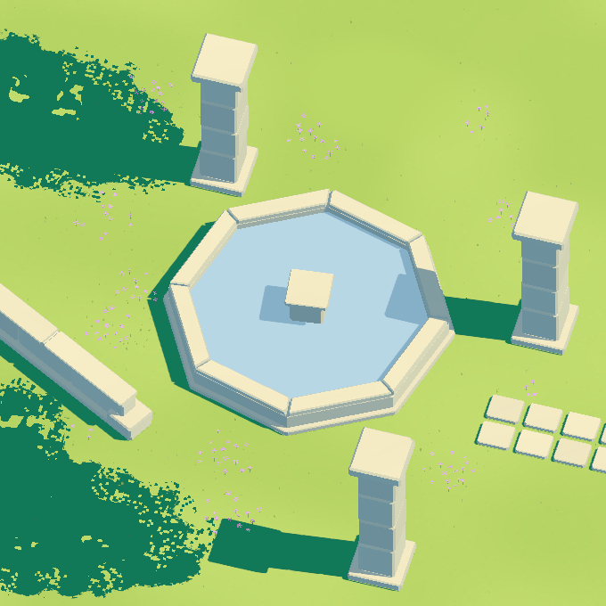
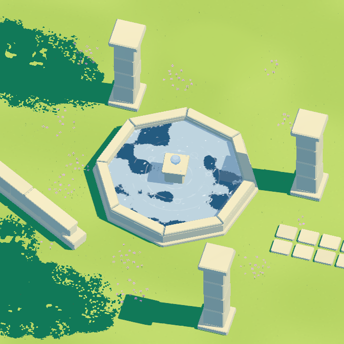

# 第六步：动态喷泉

## 范围与恢复基线

在最新发布版本恢复的新实例中先复验第五步：画布与发布前的第五步正常截图逐像素一致，建筑与植物数据匹配。随后仅制作水动效及所需控制，未重新应用旧修改，未发布任何内容。

保留固定镜头、建筑几何、植物实例、地面与树影、主光和补光。原 64 个网格节点的几何、法线、石头色差与变换指纹一致，植物四个批次的实例矩阵和颜色指纹一致。水面仍为原八边形网格，高度 **0.32**。

| 第五步 | 第六步，时间 2 秒 |
| --- | --- |
|  |  |

[5 秒动效演示](evidence/step-6/water-demo.mp4) · [像素画面](evidence/step-6/composition-pixel.png) · [水面细节](evidence/step-6/water-detail.png)

## 水面图形与颜色

`config/water.ts` 独立管理水用颜色，原场景色板保持：

| 用途 | 色值 |
| --- | --- |
| 基础水色 | `#BED4DF` |
| 深蓝反射图案 | `#245B80` |
| 遮挡水色 | `#7FA3BF` |
| 冷白高光 | `#F2FAFC` |
| 中央水体 | `#82B0D1` |

在原水材质上扩展最终颜色响应，继续使用 Three.js 的真实阴影、深度和 sRGB 输出：

- 深浅图案按喷泉局部坐标计算，深蓝图案偏重左侧，以连续噪声缓慢漂移。
- 较细噪声打碎反射边缘，避免大片圆滑图案。
- 中央波纹以短弧出现，少量高光和池壁附近泡沫补充表面信息。
- 落点波纹直接合入同一水面材质，没有新增共面叠层。
- 建筑遮挡作用于整套动态水色，高光在暗部减弱。

主要参数：flowSpeed **0.055**，reflectionThreshold **0.65**，waveSpeed **0.45**，waveStrength **0.24**。水面没有顶点位移、实时环境反射或新的外部贴图。

## 中央出水

保留石台顶高 **0.96**。新增一根从台面连接到高度 **1.18** 的短水柱，以及中心位于 1.18、基础半径 **0.18** 的低模水团。

水团使用窄幅周期形变，pulse **0.025**，保持位置稳定。顶面少量冷白高光、侧面蓝色保留体积，避免整个水团变成白点。

水柱和水团共享水体材质，接收实际建筑投影，不新增明显的水体投影。

## 水滴与几何避让

固定种子 **62026**，32 个粒子槽位，每个粒子的发射相位、速度、尺寸和落点固定。

| 参数 | 当前值 |
| --- | --- |
| 发射高度 | 1.18 |
| 水平初速度 | 0.95～1.1 |
| 向上初速度 | 0.7～0.9 |
| 重力 | 3 |
| 半径 | 0.014～0.024 |
| 单槽发射周期 | 2 秒 |
| 实际同时可见数量 | 600 秒模拟中为 16～18 |

轨迹为 `p(t) = p0 + v0*t + 0.5*g*t²`。落水时间求解至水滴底部接触高度 0.32，考虑水滴半径。

使用 2,560 段实际轨迹射线检查，未碰撞石头。下降到台座高度范围时，水滴球体距台座保守外接圆的最小剩余间距约为 **0.0652**；落点在水池八边形内，保留池壁余量。

粒子出生和消失通过短暂缩放过渡，不使用半透明叠加。实例数组按可见粒子压紧写入，隐藏槽位清为固定矩阵；实例容量与缓冲不变，完整轨迹包围范围预先建立。

## 落水波纹

每个粒子的解析落点和落水时间直接生成波纹事件，保留最近至多 **8** 组：

- 生命周期 **0.65 秒**。
- 扩散速度 **0.30**。
- 强度 **0.58**，同时按时间衰减。
- 从真实落点扩散，结束后不积累。

在多个时间点检查了波纹位置、事件年龄与粒子解析落水时间；GPU 中清空落水波纹数据后，水面图像发生对应变化，恢复后图像一致。

## 统一时间与交互

`animation/createAnimationController.ts` 提供统一时钟，默认从 **2 秒**的稳定喷泉状态开始。单帧时间推进上限 **0.05 秒**。

- 所有水动效共享同一时间。
- 暂停停止时间推进与持续绘制；切换分辨率时仍可按需重绘。
- 播放从暂停时刻接续。
- 减少动态默认暂停，允许用户主动播放，手动暂停保持。
- 可见性变化重置时间戳，隐藏时停止推进和绘制。
- 热更新清理时钟监听器、旧动画循环和所有资源。

验收参数 `?waterTime=2` 表示固定初始时间并暂停，可与 `render=pixel` 组合。调试参数不显示在产品控制栏。

## 阴影与资源

原有投影物体在本阶段保持静止，新水体只接收阴影。因此渲染器复用首次生成的建筑阴影图；上下文恢复时标记重新生成。

| 项目 | 统计 |
| --- | --- |
| 全场景网格节点 | 67 |
| 新增水动效批次 | 3：水柱、水团、水滴 |
| 原植物批次 | 4，数据保持 |
| 几何体 | 51 |
| 材质 | 6 |
| 保守峰值三角形，按 32 个槽位计 | **9,180** |
| 动效采样时实际三角形 | 随可见水滴数量变化，约 9,052～9,068 |

符合 4 个新增批次以内、15,000 三角形以内的本步目标。51 个几何体、6 个材质、5 个实例对象共 62 项释放检查通过，重复销毁不会再次释放。

在阴影变体预热后，60 帧采样期间 GPU 统计保持为 51 个几何体、2 个纹理、15 个已编译程序，没有随时间增长。600 秒纯模拟中实例与波纹缓冲保持相同引用，数据始终有限。

## 动效与关键帧

[water-demo.mp4](evidence/step-6/water-demo.mp4) 为 **680×680、5 秒、60 帧**的 MP4。使用原场景与渲染器，以 1/12 秒步长采样设计时间 2 秒至约 7 秒，再编码为 12 fps。它用于展示动效，不代表实时设备帧率。

| 时间 | 关键帧 |
| --- | --- |
| 0 秒 | [frame 00](evidence/step-6/keyframe-00.png) |
| 0.8 秒 | [frame 01](evidence/step-6/keyframe-01.png) |
| 1.6 秒 | [frame 02](evidence/step-6/keyframe-02.png) |
| 2 秒 | [frame 03](evidence/step-6/keyframe-03.png) |
| 2.4 秒 | [frame 04](evidence/step-6/keyframe-04.png) |
| 3.2 秒 | [frame 05](evidence/step-6/keyframe-05.png) |

## 阶段边界

本步只让水体运动，花草、树影及建筑保持静止。第六步完成后停在验收点；第七步处理像素尺度与整体质感，第八步再处理环境动效。本轮没有执行环境发布。

完整检查见 [第六步验收报告](step-6-verification.md)。
