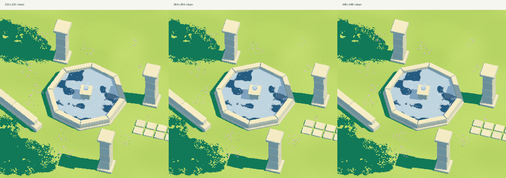

# 第七步：像素尺度与整体质感统一

本步在第六步已发布版本上推进，只调整最终采样与显示。相机、构图、石头、草花、树影、水的颜色与解析运动保持原实现。当前修改停在第七步验收点，尚未发布。

## 执行标准与完成顺序

1. **恢复基线。** 在同一窗口、同一时间 `waterTime=2` 下复核第六步正常/像素截图，确认没有遗漏或重复应用旧修改。保存原始源码摘要，锁定相机、布局、光照、几何、植物、水体和依赖。
2. **建立独立采样管线。** 像素模式先将整个三维场景画入低分辨率目标，再从每个源像素的中心取样，使用最近邻方式输出到正常设备分辨率画布。保持页面文字和控件清晰。
3. **比较三个尺度。** 同一场景、种子、时间和桌面尺寸下比较 320、384、448，再检查 DPR 2 手机。重点检查石头斜边与接缝、花头、草叶、树影碎边、水滴和白色短弧。
4. **比较整体色阶。** 比较原色 `clean` 与每通道 64 级、静态 Bayer 抖动强度 0.18 的 `soft`。只有在视觉上改善时才默认启用；保留前六步确定的色彩关系。
5. **验证真实采样与色彩。** 使用独立 GPU 色板检查输出转换，棋盘检查最近邻；分别验证半浮点目标与强制 sRGB8 备用路径。正常模式应精确匹配第六步。
6. **检查响应式与运动。** 验证桌面、手机、横屏、非整数 DPR 与运行中 DPR 改变；复验暂停、继续、减少动态、隐藏事件和模式切换。像素化只作用于图像，水滴位置和时间保持连续。
7. **检查生命周期并留存证据。** 采样 60 帧、反复切换模式、检查资源数量与上下文恢复，输出截图、对照图、参数、视频和验收记录。完成后停止，等待用户视觉验收。

## 最终选择

| 项目 | 结果 |
| --- | --- |
| 默认观看方式 | 像素预览 |
| 默认设计采样尺寸 | 长边 384 像素，方形画面通常为 384×384 |
| 输出尺寸 | CSS 尺寸 × DPR，DPR 上限 2；两种观看模式一致 |
| 缩小窗口 | 采样尺寸不超过实际输出尺寸，最低 1 像素 |
| 场景过滤 | 最近邻，关闭 mipmap；不使用抗锯齿 |
| 默认色阶处理 | `clean`，保持原色，不额外量化或抖动 |
| 对照色阶处理 | `soft`，每通道 64 级、静态 4×4 Bayer、强度 0.18 |
| 首选离屏格式 | 线性半浮点；检测 `EXT_color_buffer_float` |
| 备用离屏格式 | sRGB8，硬件完成存储编码与取样解码 |
| 最终颜色转换 | 单次线性 → sRGB 输出；不增加曝光、色调映射或模糊 |

**384 档作为当前验收版本。** 320 的块感更强，但小花、细草和接缝更容易合并为少数像素；448 保留更多细节，边缘更细。384 在保持花簇可读的同时，石头、树影和水面有清楚的像素阶梯。

`soft` 对照没有带来足够的改善，因此保留 `clean` 为默认。页面没有增加色阶开关或开发滑块；两个观看按钮与播放/暂停控件保持原来的使用方式。

非整数放大按最近邻分配物理像素：相邻源像素的显示宽度可能相差 1 个物理像素，不进行线性混合。固定画面、固定时间下像素网格不会漂移。窗口比设计网格更小时按实际输出尺寸采样，避免无效超采样；这时像素块会更细。

## 管线与代码位置

```text
场景几何 + 固定相机 + 连续水动效
              ↓
低分辨率场景目标（默认长边 384）
              ↓
源像素中心最近邻取样
              ↓
单次 sRGB 转换 → 可选静态色阶处理
              ↓
全设备分辨率画布
```

| 文件 | 本步职责 |
| --- | --- |
| `src/config/visual.ts` | 320/384/448 档、默认值、可选色阶和 URL 参数解析 |
| `src/rendering/createPixelPipeline.ts` | 离屏目标、源像素中心取样、颜色输出、备用格式与资源释放 |
| `src/rendering/createRenderer.ts` | 两种输出路径、尺寸与 DPR 监听、统计与销毁 |
| `src/rendering/releaseSceneGpuResources.ts` | 上下文丢失时清除旧 GPU 代的资源回调，保留场景与实例数据 |
| `src/config/scene.ts` | 默认观看方式改为像素；镜头与地面参数保持 |
| `src/main.ts` | 将对照参数交给渲染器；已有控件继续工作 |

目标尺寸只在实际变化时重新分配。暂停时可按需重绘；每帧不创建新目标、材质或几何。正常模式直接画到画布。静态建筑阴影继续缓存，图像采样不会改变阴影投射或实际水滴轨迹。

上下文丢失时先停止绘制，并释放已经失效的 GPU 资源与回调；保留 CPU 几何、植物矩阵和解析水体状态，恢复后重新上传和生成阴影。这样可避免旧 GPU 代在最终销毁时尝试删除已经失效的对象。

## 对照方法

在应用地址后追加以下参数；`waterTime=2` 用于统一比较并暂停，不是动画帧率设置。

| 参数 | 用途 |
| --- | --- |
| `?waterTime=2` | 默认像素 384、原色、固定时间 |
| `?waterTime=2&render=native` | 第六步相同的正常画面 |
| `?waterTime=2&pixelSize=320` | 较粗像素 |
| `?waterTime=2&pixelSize=448` | 较细像素 |
| `?waterTime=2&finish=soft` | 轻微色阶与静态抖动对照 |

无效 `pixelSize`、`finish`、`render` 回退至默认。点击播放可从固定时间继续；切换观看方式保留当前时间。备用格式可通过渲染器的配置参数在测试中强制验证，不向用户增加设置项。

## 视觉证据

[三档完整对照](evidence/step-7/resolution-comparison.png)



- [最终像素构图](evidence/step-7/composition-pixel.png)
- [正常构图](evidence/step-7/composition-native.png)
- [石缝、花簇、水体与树影局部对照](evidence/step-7/detail-comparison.png)
- [手机第六步/第七步对照](evidence/step-7/mobile-before-after.png)
- [384 原色](evidence/step-7/pixel-384-clean.png) / [384 轻微色阶](evidence/step-7/pixel-384-soft.png)
- [桌面页面](evidence/step-7/desktop-pixel.png) / [手机页面](evidence/step-7/mobile-pixel.png)
- [手机 320](evidence/step-7/mobile-320.png) / [手机 384](evidence/step-7/mobile-384.png) / [手机 448](evidence/step-7/mobile-448.png)
- [5 秒像素动效](evidence/step-7/pixel-demo.mp4)
- [完整验收记录](step-7-verification.md)

视频按 1/12 秒设计时间间隔采样，共 60 帧，不能用其编码帧率推断实际硬件性能。跨浏览器、真实设备和最终硬件性能留待第九步。

本步完成后不自动进入第八步环境动画，不发布环境。
